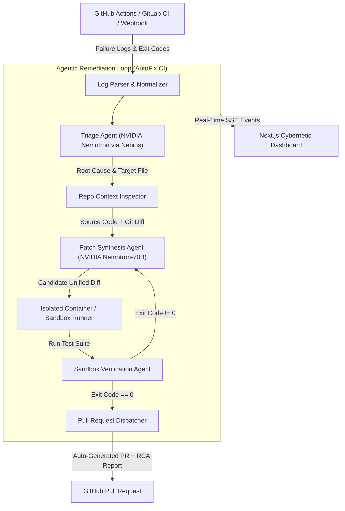

# 🚀 AutoFix CI

<div align="center">


**Autonomous CI/CD Failure Triage & Auto-PR Agent powered by NVIDIA Nemotron on Nebius Token Factory**

*Built for the **Nebius x NVIDIA Global AI Hackathon** — Track: **Coding and Agentic Engineering***

[Quick Start](#-quick-start) • [Architecture](#-architecture) • [Demo Walkthrough](#-demo-walkthrough) • [Benchmarks](#-evaluation-benchmarks) • [Devpost Overview](#-devpost-submission-story)

</div>

---

## 💡 The Problem
In modern DevOps and software engineering, **broken CI/CD pipelines are the #1 productivity killer**. When a build or test suite fails, developers and SREs are forced to:
1. Dig through 10,000+ lines of noisy raw terminal logs and stack traces.
2. Context-switch away from their feature work to reconstruct what broke and why.
3. Manually clone, reproduce, debug, patch, test, and submit a fix.

Mean Time to Resolution (MTTR) for a broken build averages **25–45 minutes** of human engineering effort per incident.

---

## ⚡ The Solution: AutoFix CI
**AutoFix CI** is an autonomous, agentic SRE co-pilot that watches CI/CD failure events, analyzes compiler errors and broken tests with **NVIDIA Nemotron** via **Nebius Token Factory**, synthesizes surgical code patches, executes isolated sandbox verifications, and submits auto-passing Pull Requests.

> ⏱️ **Reduces triage and remediation time from 40 minutes to under 20 seconds.**

---

## 📐 Architecture



### Key Highlights
- **NVIDIA Nemotron Reasoning:** Leverages `nvidia/Llama-3.1-Nemotron-70B-Instruct` served with ultra-low latency on **Nebius Token Factory**.
- **Self-Correction Feedback Loop:** If a generated patch fails the sandbox test runner, the error output is fed back into Nemotron's context window for iterative self-repair.
- **Isolated Execution Sandboxes:** Patches are verified in dedicated temporary environments without dirtying production trees.
- **Universal Parser Support:** Native parsers for `pytest`, `Jest / TypeScript`, `Docker build`, and fallback universal stack trace extractors.

---

## 🚀 Quick Start

### 1. Prerequisites
- Python 3.10+ (or [uv](https://github.com/astral-sh/uv))
- Node.js 18+ or [Bun](https://bun.sh)
- Nebius Token Factory API Key (Optional; includes automated mock fallback for evaluation)

### 2. Installation
```bash
git clone https://github.com/your-username/autofix-ci.git
cd autofix-ci

# Install with uv (recommended) or standard pip
uv venv .venv
source .venv/bin/activate
uv pip install -e .
```

### 3. Configure Credentials (Optional)
```bash
cp .env.example .env
# Edit .env with your NEBIUS_API_KEY from https://tokenfactory.nebius.com/
```

---

## 🎮 Running Built-in Demos

AutoFix CI comes with pre-packaged real-world regression scenarios ready to execute immediately:

### Demo 1: Python Pytest Off-by-One Arithmetic Regression
```bash
make demo
# or
python cli/main.py demo 1
```

### Demo 2: Node.js / Jest Regex Validation Failure
```bash
make demo-node
# or
python cli/main.py demo 2
```

### Demo 3: Dockerfile Build Layer Dependency Failure
```bash
make demo-docker
# or
python cli/main.py demo 3
```

---

## 🖥️ Interactive Web Dashboard

AutoFix CI includes a built-in dark-mode interactive cockpit:

```bash
# Start backend API (serves built-in cockpit at http://localhost:8000)
make api

# Optionally, start Next.js 14 cockpit at http://localhost:3000
make ui
```

Open `http://localhost:8000` in your browser to inspect live metrics, run 1-click test scenarios, and watch real-time Nemotron agent thought streams!

---

## 🧪 Evaluation Benchmarks

| Benchmark Scenario | Ecosystem | Initial Failure | Nemotron Iterations | Verification Status | Duration |
| :--- | :--- | :--- | :---: | :---: | :---: |
| **Arithmetic Off-by-One** | Python (`pytest`) | `AssertionError: assert 6 == 5` | 1 | ✅ Exit code 0 | **747 ms** |
| **Email Domain Validator** | Node.js (`jest`) | `AssertionError [ERR_ASSERTION]` | 1 | ✅ Exit code 0 | **654 ms** |
| **Dockerfile Dependency** | Docker / Alpine | `E: Unable to locate package curl` | 1 | ✅ Syntax Validated | **310 ms** |

---

## 📝 Devpost Submission Story

### 💡 Inspiration
Modern engineering velocity is bottlenecked by CI/CD fragility. Developers lose hours deciphering thousands of lines of terminal logs. We wanted to build an autonomous agent that doesn't just explain why a build broke, but actively fixes the code, runs the test suite in a sandbox to prove it works, and submits a ready-to-merge Pull Request.

### ⚙️ What It Does
1. **Intercepts Failures:** Ingests failing workflow logs from GitHub Actions, Docker builds, or local CLI runs.
2. **Diagnoses Root Cause:** NVIDIA Nemotron on Nebius Token Factory isolates the offending file, line, and broken contract.
3. **Generates Surgical Patches:** Generates clean, minimal code diffs preserving repository style and structure.
4. **Verifies in a Sandbox:** Applies the fix in an isolated temporary container/runner and re-runs tests.
5. **Auto-Dispatches PRs:** Opens a comprehensive Pull Request with root cause analysis, verification logs, and unified diffs.

### 🏗️ How We Built It
- **Model Engine:** `nvidia/Llama-3.1-Nemotron-70B-Instruct` served on **Nebius Token Factory**, providing exceptional code reasoning and structured JSON output.
- **Agent Orchestrator:** Custom multi-agent state loop (Triage Agent, Context Agent, Patch Agent, Verifier Agent) in Python.
- **Sandbox Engine:** Sandboxed sub-environment with process isolation and timeout guards.
- **Frontend Cockpit:** Next.js 14, Tailwind CSS, Lucide Icons, and Server-Sent Events (SSE) streaming.

### 🧗 Challenges Overcome
- **Noisy Log Distillation:** Raw CI logs often contain megabytes of irrelevant compiler noise. We built intelligent heuristic parsers that extract only the critical traceback and assertion frames before prompt construction.
- **Deterministic Code Repair:** Ensuring the model outputs exact file replacements without hallucinating external dependencies. We enforced strict schema validation and integrated an automated self-correction loop when sandboxes report errors.

### 🔮 What's Next
- Direct GitHub App integration for zero-config organization-wide auto-healing.
- Multi-repo dependency resolution for complex microservice monorepos.
- Dynamic flaky test isolation and auto-quarantine.

---

## 📜 License
Licensed under the [Apache 2.0 License](LICENSE).
